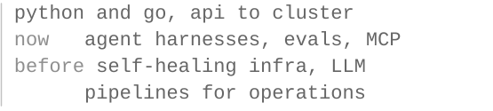
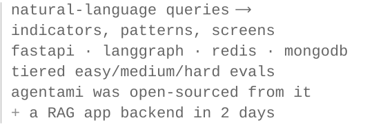
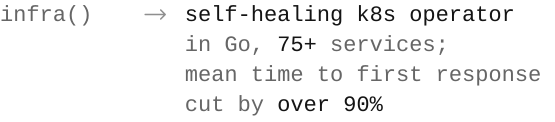
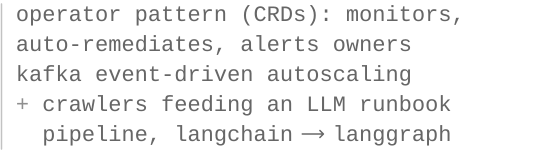
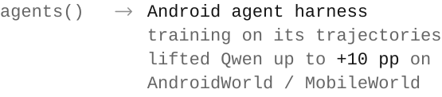
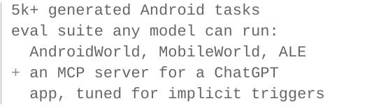

<!-- ami.sh · generated by scripts/build.py; edit the content there -->

<picture><source media="(prefers-color-scheme: dark)" srcset="assets/ami-dark.svg"></picture>

<picture><source media="(prefers-color-scheme: dark)" srcset="assets/intro-dark.svg"></picture>

<picture><source media="(prefers-color-scheme: dark)" srcset="assets/intro-out-dark.svg"></picture>

<picture><source media="(prefers-color-scheme: dark)" srcset="assets/backends-dark.svg"></picture>

<picture><source media="(prefers-color-scheme: dark)" srcset="assets/backends-out-dark.svg"></picture>

<picture><source media="(prefers-color-scheme: dark)" srcset="assets/infra-dark.svg"></picture>

<picture><source media="(prefers-color-scheme: dark)" srcset="assets/infra-out-dark.svg"></picture>

<picture><source media="(prefers-color-scheme: dark)" srcset="assets/agents-dark.svg"></picture>

<picture><source media="(prefers-color-scheme: dark)" srcset="assets/agents-out-dark.svg"></picture>

<picture><source media="(prefers-color-scheme: dark)" srcset="assets/lang-dark.svg"></picture>

<picture><source media="(prefers-color-scheme: dark)" srcset="assets/lang-out-dark.svg"></picture>

<picture><source media="(prefers-color-scheme: dark)" srcset="assets/oss-dark.svg"></picture>

[pr-reviewer](https://github.com/Ami-sh/pr-reviewer) — one-shot LLM PR review that tries to refute its own findings

[agentami](https://github.com/Ami-sh/agentami) — a LangGraph agent that picks its top-k tools per turn · on PyPI

[Hangman](https://github.com/Ami-sh/Hangman) — ~51% win rate on unseen words vs an 18% baseline

[LeetCode](https://leetcode.com/u/f20191386/) · [Stack&nbsp;Overflow](https://stackoverflow.com/users/16179688/amish-gupta) · [Physics&nbsp;SE](https://physics.stackexchange.com/users/274874/amish-gupta) · [Math&nbsp;SE](https://math.stackexchange.com/users/824283/amish-gupta)
