<!-- ami.sh · artwork generated by scripts/build.py (edit the content there) -->

<picture><source media="(max-width: 600px)" srcset="assets/hero-mobile.svg"></picture> 
<picture><source media="(max-width: 600px)" srcset="assets/stats-mobile.svg"></picture> 
<a href="https://github.com/Ami-sh/pr-reviewer"><picture><source media="(max-width: 600px)" srcset="assets/card-pr-reviewer-mobile.svg"></picture></a><a href="https://github.com/Ami-sh/agentami"><picture><source media="(max-width: 600px)" srcset="assets/card-agentami-mobile.svg"></picture></a> 

