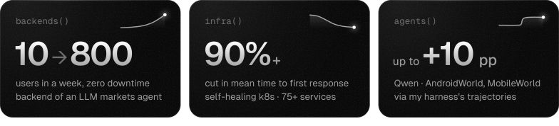
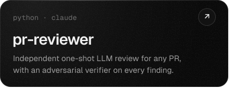
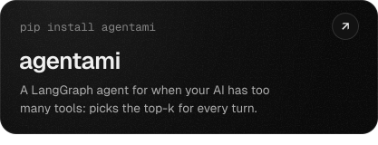
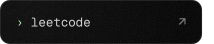

<!-- ami.sh · artwork generated by scripts/build.py (edit the content there) -->

<picture><source media="(prefers-reduced-motion: reduce) and (max-width: 1011px)" srcset="assets/hero-compact-still.svg" width="400"><source media="(prefers-reduced-motion: reduce)" srcset="assets/hero-still.svg"><source media="(max-width: 1011px)" srcset="assets/hero-compact.svg" width="400"></picture> 
<picture><source media="(max-width: 1011px)" srcset="assets/stats-compact.svg" width="400"></picture> 
<a href="https://github.com/Ami-sh/pr-reviewer"><picture><source media="(max-width: 1011px)" srcset="assets/card-pr-reviewer-compact.svg" width="400"></picture></a><a href="https://github.com/Ami-sh/agentami"><picture><source media="(max-width: 1011px)" srcset="assets/card-agentami-compact.svg" width="400"></picture></a> 
<a href="https://leetcode.com/u/f20191386/"><picture><source media="(max-width: 600px)" srcset="assets/link-leetcode-compact.svg"></picture></a><a href="https://stackoverflow.com/users/16179688/amish-gupta"><picture><source media="(max-width: 600px)" srcset="assets/link-stack-overflow-compact.svg"></picture></a><a href="https://physics.stackexchange.com/users/274874/amish-gupta"><picture><source media="(max-width: 600px)" srcset="assets/link-physics-se-compact.svg"></picture></a><a href="https://math.stackexchange.com/users/824283/amish-gupta"><picture><source media="(max-width: 600px)" srcset="assets/link-math-se-compact.svg"></picture></a>

