<!-- Profile README for github.com/Ami-sh. No employers / organisations are listed here on purpose. -->
<!-- The header is assets/terminal.svg, generated by scripts/terminal_svg.py — edit LINES there and re-run. -->

<p align="center">
  
</p>

### `$ cat about.txt`

```text
I build scalable backends, infra and agentic systems.

  - services that keep up under load and fail gracefully when they don't
  - async, event-driven pipelines: pollers, streams, backoff with jitter
  - LLM agents that hold up in production: tool routing, context pruning,
    and independent review loops that try to refute their own findings
```

### `$ ls -l ~/featured`

| repo | what it does | stack |
|---|---|---|
| [**`pr-reviewer`**](https://github.com/Ami-sh/pr-reviewer) | Independent one-shot LLM reviewer for any GitHub PR: parallel review lenses (correctness, security, tests, reward-hacking) and an adversarial verifier that tries to refute every finding before it reaches you | `python` `claude` |
| [**`agentami`**](https://github.com/Ami-sh/agentami) | Drop-in LangGraph agent for when your AI has too many tools: picks the top-k relevant tools per turn and prunes context to stay under token limits. `pip install agentami` | `python` `langgraph` |
| [**`hangman-solver`**](https://github.com/Ami-sh/Hangman) | Regex-template similarity scoring tuned with Bayesian optimisation (Optuna): **~51%** win rate on unseen words vs an 18% baseline | `python` `optuna` |
| [**`masked-face-verify`**](https://github.com/Ami-sh/MaskedFaceVerification) | Verifies a masked face against an unmasked photo by normalising the lower half of both faces before DeepFace | `python` `cv` |

<details>
<summary><code>$ ls ~/archive</code></summary>
<br/>

| repo | what it does |
|---|---|
| [`Travelling-Salesman`](https://github.com/Ami-sh/Travelling-Salesman) | Genetic algorithms (elimination, mutation, reproduction variants) for TSP |
| [`Prediction_Algorithms`](https://github.com/Ami-sh/Prediction_Algorithms) | ANN, KNN, MLR, Random Forest and SVR side by side |
| [`Newton-Raphson`](https://github.com/Ami-sh/Newton-Raphson) | All roots of any polynomial via Newton-Raphson |
| [`Biped_gait_environment`](https://github.com/Ami-sh/Biped_gait_environment) | Pygame environment for biped gait generation (WIP) |
| [`Turtlesim-Spiral-trajectory`](https://github.com/Ami-sh/Turtlesim-Spiral-trajectory) | ROS turtlesim spiral trajectory |
| [`Edge_detection`](https://github.com/Ami-sh/Edge_detection) | A hand-written edge detector |

</details>

### `$ which tools`

<p>
  
  
  
  
  
  
</p>

```console
~ $ exit
[process completed]
```
